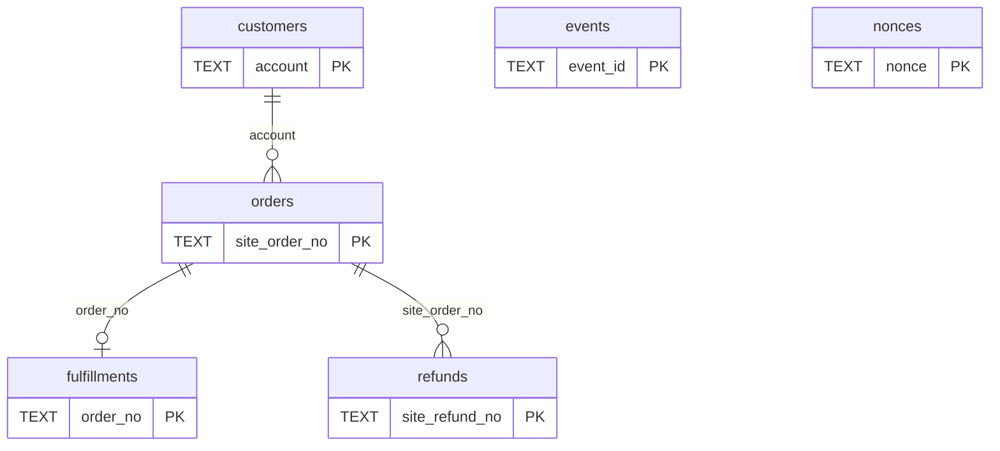

# shop-site 数据库文档

- 用途：本站 SQLite 数据库的表结构；表名、列名与 `lib/db.js` 里的建表语句完全一致，改表先改本文件。
- 状态：与代码同一次提交维护（开发规范第 5 节）。
- 依据：契约 v0.15.3（`contracts/site-api.yaml`、`contracts/common.md`）；用途与流程见 `docs/design.md`。

数据库是 Node 22 内置的 `node:sqlite`，文件路径由 `SHOP_DB_PATH` 指定（容器里为 `/data/shop.db`）。启动时 `CREATE TABLE IF NOT EXISTS` 建表，没有迁移脚本：本站是示例，表结构变化时由 ops 清空数据文件重建。同一个数据文件只能由一个进程使用（随机串、开通的原子性都依赖这一点）。

（`orders` 与 `customers` 之间没有外键：`paycode`、`shop` 来源的订单账号不一定登录过本站。）

## customers

登录过的账号；校验客户账号接口以此判断账号是否存在。

| 列 | 类型 | 约束 | 说明 |
| --- | --- | --- | --- |
| `account` | TEXT | 主键 | 账号名，1～64 个字符 |
| `created_at` | TEXT | 非空 | RFC 3339 UTC 时间 |

## orders

本地订单。`amount`、`currency` 在调用 `createOrder` 之前写入，通知核对用。

| 列 | 类型 | 约束 | 说明 |
| --- | --- | --- | --- |
| `site_order_no` | TEXT | 主键 | 站点订单号（`S` + 14 位时间 + 8 位随机十六进制）；`paycode`、`shop` 来源的订单没有站点订单号，用平台订单号代替 |
| `account` | TEXT | 非空 | 客户账号 |
| `product_id` | TEXT | 可空 | 商品编号；`paycode`、`shop` 来源的订单为空 |
| `amount` | TEXT | 非空 | 订单金额（固定小数位字符串） |
| `currency` | TEXT | 非空 | `CNY`、`USDT` |
| `pay_method` | TEXT | 非空 | `wechat`、`alipay`、`usdt`（`shop` 来源为 `shop`） |
| `payable_amount` | TEXT | 可空 | 平台返回的应付金额（USDT 带尾数） |
| `order_no` | TEXT | 唯一，可空 | 平台订单号；`createOrder` 成功后写入 |
| `status` | TEXT | 非空 | 本地状态：`created`、`paid`（已开通）、`closed` |
| `payment_json` | TEXT | 可空 | 下单返回的 `payment`（JSON 原文） |
| `created_at`、`updated_at` | TEXT | 非空 | RFC 3339 UTC 时间 |

索引：`orders_account_created (account, created_at)`，用于“我的订单”。

## fulfillments

开通记录。以 `order_no` 为主键插入，插入冲突即视为已开通；与更新 `orders.status` 在同一个事务里。

| 列 | 类型 | 约束 | 说明 |
| --- | --- | --- | --- |
| `order_no` | TEXT | 主键 | 平台订单号 |
| `site_order_no` | TEXT | 非空 | 对应的本地订单 |
| `account` | TEXT | 非空 | 给谁开通（查单返回的 `customerAccount`） |
| `amount`、`currency` | TEXT | 非空 | 查单返回的订单金额和币种 |
| `created_at` | TEXT | 非空 | 开通时间 |

## events

通知去重。开通事务提交之后才写入，所以处理中途失败的事件下次重试仍会处理。

| 列 | 类型 | 约束 | 说明 |
| --- | --- | --- | --- |
| `event_id` | TEXT | 主键 | 通知的 `eventId` |
| `received_at` | TEXT | 非空 | 处理完成时间 |

## nonces

平台请求的随机串，10 分钟内重复拒绝；每次写入前删除过期的行。

| 列 | 类型 | 约束 | 说明 |
| --- | --- | --- | --- |
| `nonce` | TEXT | 主键 | `<站点编号>\n<随机串>` |
| `seen_at` | INTEGER | 非空 | 毫秒时间戳 |

## refunds

本站申请的退款，以及后台发起（`admin`）、通道退回（`upstream`）的退款（来自通知）。

| 列 | 类型 | 约束 | 说明 |
| --- | --- | --- | --- |
| `site_refund_no` | TEXT | 主键 | 站点退款号（`R` + 14 位时间 + 8 位随机十六进制）；非本站申请的退款用 `X-<refundNo>` |
| `site_order_no` | TEXT | 非空 | 对应的本地订单（找不到本地订单时为平台订单号） |
| `refund_no` | TEXT | 唯一，可空 | 平台退款号；申请成功后写入 |
| `amount` | TEXT | 非空 | 退款金额 |
| `status` | TEXT | 非空 | 本地 `created`（已记录、尚无平台回复）、`failed`（平台拒绝）；其余为平台状态 `reviewing`、`processing`、`succeeded`、`failed`、`manual` |
| `reason` | TEXT | 可空 | 退款原因 |
| `created_at`、`updated_at` | TEXT | 非空 | RFC 3339 UTC 时间 |

索引：`refunds_order (site_order_no)`。
