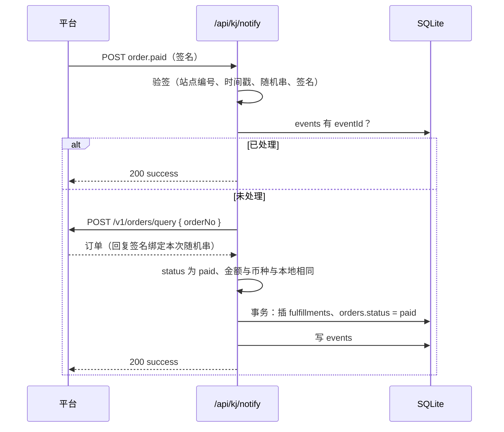
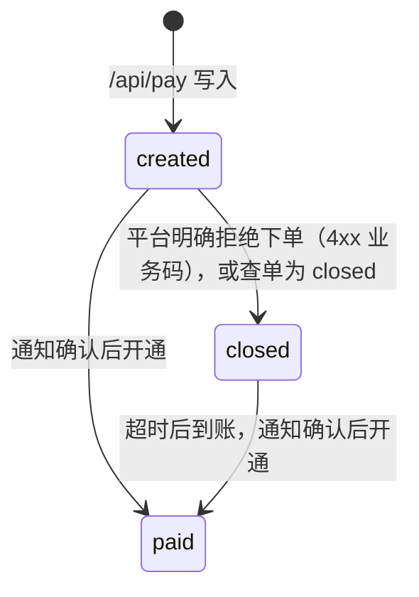

# shop-site（示例商品站）设计文档

- 用途：本项目的职责、页面与接口、模块划分、关键流程、技术约定、测试清单。代码必须与本文件一致（开发规范第 1 节）。
- 状态：初稿（架构师 2026-11-14 写；项目会话接手后由项目会话维护）
- 依据：契约 v0.17.3（`contracts/site-api.yaml`、`contracts/common.md` 第 1～9、17 节、`contracts/testdata/signature-cases.json`；每次动手前与 `contracts/MANIFEST.json` 核对，落后时先按开发规范第 7 节更新）

## 1. 职责与边界

一个按站点接口（C1）接入本平台的**示例商品站**：负责人用它在沙箱和正式环境走完整的订单流程（下单 → 付款 → 通知 → 查单确认 → 开通 → 退款），将来作为参考实现交给加盟方的开发者。

- 依赖：只调用平台的站点接口（`POST /v1/orders`、`/v1/orders/query`、`/v1/refunds`、`/v1/refunds/query`），只接收平台的通知和校验客户账号请求。不调用任何内部接口，不读其他项目的代码。
- 被谁依赖：负责人（测试）、ops（部署：本项目只提供 `Dockerfile` 和环境变量清单）、将来的加盟方。
- 不做：购物车、商品管理、后台、真实的账号体系（登录只输入账号名）、多语言、支付以外的业务。
- 对外性：页面文字、代码、注释按 `common.md` 第 17 节对外材料的规则写（只说"平台"，不出现内部岗位、流程、项目名）。

## 2. 对外接口

| 方向 | 接口 | 说明 |
| --- | --- | --- |
| 本站 → 平台 | C1 `createOrder`、`queryOrder`、`createRefund`、`queryRefund` | `lib/kj-client.js`，每次请求签名、回复验签 |
| 平台 → 本站 | C1 `orderEvent`（通知地址 `/api/kj/notify`） | 验签、按 `eventId` 去重、`order.paid` 先查单确认再开通、回复 `success` |
| 平台 → 本站 | C1 `verifyCustomer`（校验客户账号地址 `/api/kj/verify-customer`） | 验签、查本地客户、签名回复 |

通知地址和校验客户账号地址由平台在后台为站点配置为 `https://<本站域名>/api/kj/notify`、`https://<本站域名>/api/kj/verify-customer`。

## 3. 页面与路由

| 路径 | 内容 |
| --- | --- |
| `/` | 商品列表：固定商品表（服务端常量，至少 3 个 CNY、1 个 USDT），每个商品一个"购买"按钮；未登录时先跳转登录 |
| `/login` | 输入账号名（即客户账号 `customerAccount`，1～64 个字符）即登录，写 HttpOnly cookie；无密码（示例用） |
| `/buy/<商品编号>` | 选支付方式（契约 `PayMethod`：CNY 商品 `wechat`、`alipay`；USDT 商品 `usdt`。没有 `shop`：平台可能把 `alipay` 订单分配给店铺码，站点不感知），提交后服务端按商品表定价、记本地订单、调用 `createOrder`，跳到付款页 |
| `/pay/<siteOrderNo>` | 付款页：按 `payment.type` 展示（`qrcode` 用本地生成二维码图片；`url`/`url_qrcode` 给跳转按钮和二维码；`usdt` 显示网络、地址、应付金额并提示精确转账；`qrcodeImage` 直接显示；其他 `type`（含 `bank`、`app`、`form`）提示换支付方式）；`created` 且没有平台订单号的订单（下单结果未知）显示"结果未知，请稍后在我的订单里查看，不要重复下单"和"重试下单"；显示订单金额与应付金额；每 3 秒调用本站 `/api/orders/<siteOrderNo>` 刷新状态，已开通时显示"已开通"；订单 `closed` 后改为每 30 秒轮询并提示"若已付款请勿重复下单，开通后自动显示；未付款请重新下单"（超时后到账仍会通知开通）；有平台订单号的 `created` 订单提示"付款后由平台核对，可能需要几分钟"；查单返回业务错误码时提示"平台未找到该订单/配置有误，请联系站点" |
| `/orders` | 我的订单：当前账号的订单（站点订单号、商品、金额、币种、支付方式、状态、是否已开通、时间），每行"查看"和"申请退款"（已支付且按本地退款记录可退金额大于 0 时）；支付方式、订单状态、平台状态、退款状态显示中文（`lib/orders.js` 的映射表，查不到时显示原值） |
| `/orders/<siteOrderNo>` | 订单详情：本地记录 + 调用 `queryOrder` 的最新结果（`orderNo`、`status`、`paidAmount`、`refundedAmount`、`expireAt`）、退款记录、"申请退款"（金额、原因） |
| `/api/login` | POST 表单 `account`，登录页提交用；账号合格则记入 `customers`、写 cookie（7 天有效；`x-forwarded-proto` 为 `https` 或 `NODE_ENV=production` 时加 `Secure`）并 303 跳回 `/`，不合格跳回 `/login?error=1` |
| `/api/pay` | POST `{ productId, payMethod }`，金额和币种只看服务端商品表（来自接入文档 Next.js 示例的"去支付"）；成功回 `{ code: "OK", data: { siteOrderNo } }`；未登录 401；商品不存在 404（`PRODUCT_NOT_FOUND`）；支付方式与币种不符 400；平台结果未知回 502/503，`data` 带 `{ siteOrderNo }`（本地订单保留 `created`，页面跳到付款页） |
| `/api/pay/retry` | POST `{ siteOrderNo }`，付款页上"结果未知"的订单（没有平台订单号）用同一个 `siteOrderNo` 再调 `createOrder`（平台幂等）；订单不是本人的 404，已关闭 409，已有平台订单号直接成功 |
| `/api/orders/<siteOrderNo>` | GET，本站订单状态（本地 + 查单）；只返回当前账号自己的订单；字段 `status`、`fulfilled`、`stale`（查单结果未知）、`queryError`（查单返回的业务错误码，非暂时性）、`remote` |
| `/api/refund` | POST `{ siteOrderNo, amount, reason }`，生成 `siteRefundNo`，调用 `createRefund`；金额必须大于 0 |
| `/api/kj/notify` | 平台通知地址（第 2 节） |
| `/api/kj/verify-customer` | 校验客户账号地址（第 2 节）；账号存在的定义：本地 `customers` 表里有（登录过一次即有） |
| `/healthz` | 存活检查，200 |

## 4. 模块划分

| 目录 | 内容 |
| --- | --- |
| `lib/kj-sign.js`、`kj-client.js`、`kj-notify.js`、`kj-payment.js`、`kj-verify-customer.js` | 来自接入文档的 Next.js 示例（2026-11-14 复制，已通过标准用例），按需小改；改动记在本文件第 9 节 |
| `lib/config.js` | 环境变量：`KJ_BASE_URL`（接口地址，`https://<平台域名>`，不带路径）、`KJ_SITE_ID`、`KJ_SECRET`、`SHOP_DB_PATH`（SQLite 文件路径，默认 `./data/shop.db`）、`SHOP_SESSION_SECRET`（签 cookie）、`PORT`（默认 18120）。设置了 `KJ_SECRETS_FILE` 时读取保密文件（`common.md` 第 13 节）：每行 `名称=值`，只允许 `KJ_SECRET`、`SHOP_SESSION_SECRET`，与环境变量合并；读不到、行无 `=`、行尾 CR、名称重复或不认识、与环境变量同名都拒绝启动（错误只写名称或行号）。`NODE_ENV=production` 下这两项只能来自文件，且文件权限不得宽于 `0400`（是否在 tmpfs 上由部署保证，代码不检查）；日志只写读到的名称。由 `lib/site.js` 的 `getSite()` 在第一次使用时读一次 |
| `lib/db.js` | SQLite（`node:sqlite`，Node 22 内置，不加原生依赖）：建表（表结构见 `docs/database.md`）、本地订单、退款、开通记录、事件去重、随机串（同时实现 `NonceStore`，替代示例里的内存版）、客户 |
| `lib/products.js` | 固定商品表（编号、名称、价格字符串、币种）和各币种可用的支付方式 |
| `lib/session.js` | 登录 cookie：HMAC 签名"账号名 + 过期时间（Unix 秒，7 天）"，读取时校验签名和过期；`Secure` 判断 |
| `lib/orders.js` | 下单、重试下单、订单状态、退款、退款通知、通知用的存储适配（`SiteStore`）；页面和接口只调用这里，数据库和平台客户端作为参数传入，便于测试 |
| `lib/site.js` | 第一次使用时读配置并组装数据库和平台客户端（用 `globalThis` 保证进程内只有一份）；接口共用的登录账号、错误回复、请求体解析 |
| `app/` | Next.js App Router 页面与路由（第 3 节）；页面是 `.jsx`，路由是 `route.js`（只用标准 `Request`/`Response`，测试里直接调用）；`buy-form.jsx`、`pay-status.jsx`、`refund-form.jsx` 是需要浏览器交互的客户端组件 |
| `test/` | `node --test`：签名标准用例（必需测试 `signature-cases`）、通知处理（验签失败/随机串重复/查单不是 `paid`/金额不符/账号不符/`orderNo` 不一致/来源缺失或不认识/重复 `eventId`/并发只开通一次/`api`、`paycode`、`shop` 来源/`closed` 订单收到通知/下单超时后通知/退款通知及其重复）、`/api/pay` 定价不信任浏览器与错误映射、结果未知与重试下单、订单状态（`stale`、`queryError`）、退款（金额 0、结果未知、并发）、会话过期与 `Secure`、校验客户账号验签与回复签名、付款页对 `payment` 的处理、订单页显示平台拒绝的错误码（`test/order-rejection.test.mjs`：拒绝后记录、结果未知不写、再次成功清空、旧库补列）、买家可见文字（`test/buyer-text.test.mjs`：错误码映射、501 处理、状态中文、页面文案）；用独立实现的假平台 `test/fake-platform.mjs`（不复用 `lib/kj-sign.js`） |
| `Dockerfile` | 多阶段：`node:22@sha256:0e5f906573693feaa1e21057ebdcfdb5bd5021f050b2dc7c9deceb629c7da2a8` 构建（`next build`），`node:22-slim@sha256:de170b39439eb0e5a3444ad7d60b015614a381e10fecae2e30ec9e735122f38d` 运行（`next start`，`USER node`，`HEALTHCHECK` 请求 `/healthz`）；数据目录 `/data` 由编排挂卷 |

## 5. 表结构

表结构、ER 图和各列说明见 `docs/database.md`（`lib/db.js` 建表）。要点：开通靠 `fulfillments` 主键幂等：以平台订单号为主键插入，冲突即视为已开通，同一事务里更新 `orders.status`（接入文档《开通的原子写法》）；`eventId` 去重不在这个事务里，提交之后再记 `events`，所以处理中途失败的事件重试时会再处理一遍，由主键保证不会重复开通。

## 6. 关键流程

通知与开通（跨服务时序）：

本地订单状态：

错误处理：验签失败回 401；查单失败（网络错误、回复验签失败、平台 5xx）回 500，不记 `eventId`，等平台重试；查单不是 `paid`、金额或币种不符、本地没有该 `siteOrderNo` 回 409，不开通；`order.paid` 以外不认识的事件记日志并回 `success`。

步骤：

1. 购买：登录态取账号 → `/api/pay` 按商品表定价 → 写 `orders`（`created`） → `createOrder`（`siteOrderNo` 为 `S` + 时间 + 随机）→ 保存 `orderNo`、`payment` → 跳付款页。`createOrder` 结果未知（网络错误、回复验签失败回 502；`INTERNAL_ERROR`/`UNAVAILABLE`、5xx 回 503）时本地订单保留 `created`（平台可能已建单，不置 `closed`），提示"结果未知，请稍后在我的订单里查看，不要重复下单"，付款页提供"重试下单"（同一个 `siteOrderNo` 再调 `createOrder`，幂等），之后的通知仍能开通；只有平台明确的业务错误（4xx 业务码）才置 `closed`，买家看到的是中文说明：`SITE_DISABLED`、`PAY_METHOD_UNAVAILABLE`、`RATE_LIMITED`（"请求过于频繁，请稍后再试"，下单时附"未支付的订单过多"）、`AMOUNT_OUT_OF_RANGE` 等业务码有各自的说明，其余通用错误码（`INVALID_PARAM`、`UNAUTHORIZED`、`CONFLICT`、`NOT_FOUND`、`NOT_IMPLEMENTED` 等）统一显示"下单失败，请稍后再试"（退款为"退款失败，请稍后再试"），平台原文只写日志。501 `NOT_IMPLEMENTED` 是"功能未提供"，不算结果未知：订单置 `closed`，不提示"不要重复下单"，不提供"重试下单"。明确拒绝时还把错误码和说明（`errorText` 的结果，不是平台原始 `message`）写入 `orders.last_error_code`、`orders.last_error_text`，再次提交成功时清空；结果未知、回复验签失败不写。订单详情页对没有平台订单号且有 `last_error_code` 的订单显示"平台拒绝了这笔订单：<说明>（错误码 <code>）"，订单有商品时附"重新下单"链接（`/buy/<商品编号>`）；没有错误码时仍显示"订单尚未提交到平台。"。
2. 通知：验签（站点编号、5 分钟、随机串 10 分钟、签名）→ `eventId` 已有则直接 `success` → `order.paid`：`queryOrder` 确认 `orderNo` 一致、`paid`；`source` 为 `api` 时 `amount`/`currency`/`customerAccount` 与本地订单相同（账号不一致回 409 不开通）；`paycode`/`shop` 时本地无记录，按查单返回的 `customerAccount`、`amount` 建一条订单并开通（没有 `customerAccount` 不开通）；`source` 缺失或不认识不开通 → 事务里插 `fulfillments` + 更新 `orders.status`（本地订单是 `created` 或 `closed` 都能开通）→ 提交后记 `eventId` → `success`；不通过时记日志、不回 `success`。`refund.succeeded`/`refund.failed` 以验签为准，不再查单，更新 `refunds`（没有本地记录的退款也记一条，`source` 可能是 `admin`、`upstream`，站点退款号写 `X-<refundNo>`），`eventId` 去重保证幂等（同一 `refundNo` 的重复通知只更新同一条记录）。
3. 付款页刷新：`/api/orders/<no>` 先看本地，本地状态为 `created` 时才调用 `queryOrder`（本地已是 `closed` 或 `paid` 的订单，轮询只读本地，不再查单，收到通知开通后状态才变）；结果未知（5xx、网络错误、验签失败）时返回上次本地状态并标 `stale: true`，不当作未支付；查单返回明确的业务错误码（`NOT_FOUND`、`INVALID_PARAM`、`UNAUTHORIZED` 等）时不标 `stale`，返回 `queryError`，页面提示"平台未找到该订单/配置有误，请联系站点"。订单详情页（GET）也会触发查单，查到平台订单已关闭且本地仍是 `created` 时回写 `closed`。是否"已开通"只看本地记录（`fulfilled`），开通只在通知处理里发生；查单看到 `paid` 但还没收到通知时页面显示"正在开通"。
4. 退款：`/api/refund` 只接受当前账号自己、已开通的订单；金额必须是该币种固定小数位的字符串且大于 0；先写 `refunds`（`created`）再调用 `createRefund`（用平台订单号），成功后记 `refundNo` 和状态，平台明确拒绝（4xx 业务码）记 `failed`，结果未知（网络错误、验签失败、5xx、`INTERNAL_ERROR`/`UNAVAILABLE`）回 503、记录保留为 `created`（平台可能已受理，以后续通知为准）；可退金额由平台判断（`REFUND_EXCEEDS` 等有中文说明），订单详情页用查单的 `refundedAmount` 计算可退金额只用于显示。

## 7. 技术约定

- Node 22、Next.js 16（App Router，JavaScript，不用 TypeScript，便于加盟方照抄）、React。依赖只有 `next`、`react`、`react-dom` 和生成二维码的 `qrcode`（纯 JS）；新增依赖先在这里写明理由。
- 数据库 `node:sqlite`（内置；运行时会打印实验性提示，可接受；换成 `better-sqlite3` 需要原生构建，不用）。
- 测试用 `node --test test/*.test.mjs`（Node 22 的 `node --test` 不接受目录参数），不引入测试框架。
- 没有 TypeScript：`lint` 对 `lib/`、`app/`、`test/` 下的全部 `.js`、`.mjs` 文件运行 `node --check`（语法检查；`.jsx` 页面由 `next build` 编译检查），`typecheck` 同 `lint`。
- 升级到 Next.js 16（T-002）：Next.js 15 依赖的 `postcss` 有 high 级别漏洞（GHSA-6g55-p6wh-862q 等），发布打包的审计会拒绝；16 修复后 `npm audit --audit-level=high` 为 0。Next.js 16 默认用 Turbopack 构建，原来 `next.config.mjs` 里为 `node:sqlite` 写的 webpack 配置已删除（Turbopack 把 Node 内置模块当作外部模块）；路由和页面的 `params` 本来就按 Promise 读取，无需改动。
- `npm`、`npx` 只在容器里运行；端口 18120（`docs/architecture/ports-and-names.md`）。
- 金额一律字符串，比较用字符串相等；不做浮点运算。
- 页面文字中文、简洁；不写平台的内部信息。
- 保密：`KJ_SECRET`、`SHOP_SESSION_SECRET` 开发下可以从环境变量读，也可以从 `KJ_SECRETS_FILE` 指向的保密文件读；`production` 下只能从文件读（第 4 节）。不写日志（只记名称），不进仓库。

## 8. 部署（由 ops 做，本项目提供）

- `Dockerfile`（第 4 节）、监听 `PORT`、`/healthz` 返回 200。
- 环境变量清单（第 4 节 `lib/config.js`），`SHOP_DB_PATH=/data/shop.db`；正式环境另设 `KJ_SECRETS_FILE`，两项保密内容放在该文件里。
- 正式环境：ops 把它作为独立服务挂在反向代理后面、单独域名；通知地址和校验客户账号地址在平台后台配置。

## 9. 允许的预留与变更记录

- 允许的预留：无。
- 变更记录：T-005 买家可见文字与错误处理见第 6 节第 1、3 步；2026-11-14 初稿（架构师）；2026-11-14 第 3 节支付方式按契约 `PayMethod` 改为三种（项目会话 T-001 首次运行时指出）。
- T-001（行走的骨架）对来自接入文档示例的 `lib/` 文件的改动：
  - `kj-payment.js`：本站只提供微信、支付宝和 USDT，`KNOWN_PAYMENT_TYPES` 去掉 `bank`、`app`、`form`（遇到按"不认识"提示换支付方式，不渲染平台给的 HTML）；`usdt` 要求 `network`、`address`、`amount` 都是非空字符串，只返回这三个字段。
  - `kj-sign.js` 的 `MemoryNonceStore` 不再使用，随机串由 `lib/db.js` 的 `nonces` 表保存（进程重启后仍有效）；示例文件里的类原样保留。
  - 其余 4 个文件未改动。
- T-002 对示例文件的改动：`kj-notify.js` 的 `confirmPaidOrder`：`source` 为 `api` 时核对查单返回的 `customerAccount` 与本地订单账号一致（`SiteStore.findOrderBySiteOrderNo` 多返回 `account`）；`paycode`/`shop` 要求 `customerAccount` 为非空字符串。
- T-002 其他变更：新增 `/api/pay/retry` 和 `app/pay/[no]/retry-order.jsx`；`lib/session.js` 的 cookie 带过期时间；`createOrder`/`createRefund` 结果未知不当作失败；`/api/orders/<no>` 增加 `queryError`；删除 `next.config.mjs` 的 webpack 配置。
- T-001 对设计初稿的其他调整：新增 `/api/login`（登录页表单提交）、`lib/orders.js`、`lib/site.js`；`orders` 表增加 `payable_amount` 列、`product_id` 可空（`paycode`/`shop` 来源的订单没有商品），表结构移到 `docs/database.md`；测试命令改为 `node --test test/*.test.mjs`。
- 已知限制：登录没有密码；SQLite 数据文件只能由一个进程使用，不能多实例共用；`paycode`/`shop` 来源的订单没有站点订单号，本地用平台订单号代替（订单详情用平台订单号查单）；退款只查本地记录和通知，没有主动调用 `queryRefund` 刷新状态。
